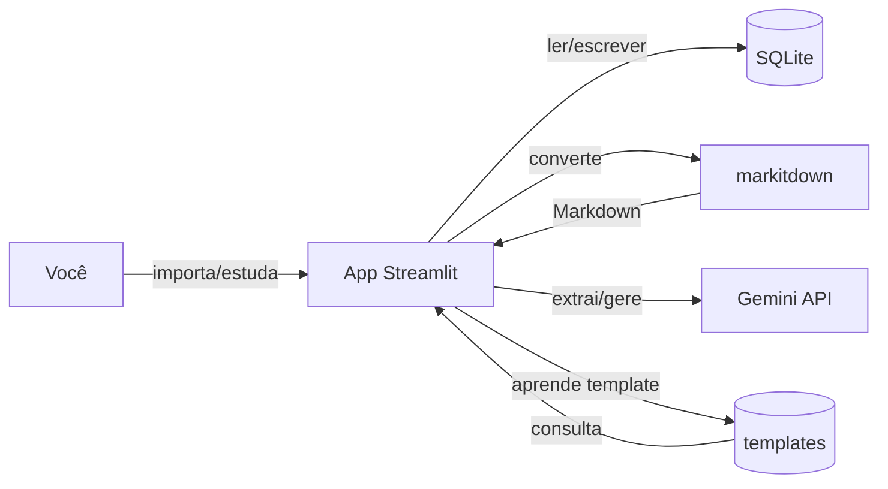

# PRD — QAConcurso (App de Questões Multi-Banca)

**Versão:** 1.0.0  
**Status:** Aprovado para desenvolvimento  
**Idioma:** Documentação em pt-BR; código/identificadores em inglês.  
**Dono do produto:** Você (usuário único no MVP)  
**Arquiteto:** opencode (decisões técnicas delegadas)

---

## Controle do documento

| Versão | Data | Autor | Mudança |
|---|---|---|---|
| 1.0.0 | 2026-07-21 | opencode | PRD completo pós-refinamento: multi-banca com templates por banca, feedback visual, custo controlado, importação simplificada |

Toda mudança de escopo gera nova versão e registro no Changelog.

---

## Contexto

Você estuda para concursos públicos de diferentes bancas (Cesgranrio, FCC, FGV) e quer um único app pessoal que:

- Importe provas reais de qualquer banca
- Gere novas questões no estilo de cada banca
- Permita estudar e revisar erros

O app atual (QAConcurso) já faz isso mas precisa de refinamentos: suporte a múltiplas bancas com templates de estilo, feedback visual durante operações longas, e importação mais robusta.

---

## Problema

1. Importar provas de diferentes bancas exige configurar manualmente o formato de cada uma
2. Geração de questões por IA sem contexto da banca resulta em formato genérico e infiel
3. Sem feedback visual durante chamadas de IA (10-30s congelado), o usuário não sabe se está processando
4. Custo de IA sem controle pode escalar

---

## Visão do produto

Um app local (Streamlit + SQLite) onde você:

1. (Importar) Faz upload de provas reais em PDF → IA extrai questões + aprende o template da banca
2. (Gerar) Escolhe banca + matéria → IA gera questões no estilo da banca usando o template aprendido
3. (Estudar) Responde com feedback imediato
4. (Revisar) Revê apenas os erros

A IA fica na borda (geração/extração). O núcleo (responder, revisar) funciona sem ela.

---

## Fluxo principal

```
[Upload PDF] → markitdown → Markdown bruto
  → [Template existe?] Sim → IA extrai questões usando template
  → [Template existe?] Não → IA extrai questões + aprende layout → salva template
  → Questões validadas (INV-1) → questions (DB)

[Escolher banca + matéria + N]
  → Monta prompt com template da banca
  → IA gera N questões → validação (INV-4, INV-5) → questions (DB)

[Estudar] → carrega questões por banca/matéria → responde → attempts (DB)
[Revisar] → filtra attempts.correct=false → responde de novo
```

---

## Invariantes

- **INV-1** — Toda questão precisa de enunciado, ≥2 alternativas e gabarito válido (1 ou mais corretas), independente do tipo (múltipla escolha ou certo/errado).
- **INV-2** — Nenhuma operação apaga dados permanentemente sem confirmação explícita.
- **INV-3** — O sistema funciona sem IA: responder questões importadas nunca depende de chamada de IA.
- **INV-4** — Toda questão `source=ai` passa pela mesma validação das importadas.
- **INV-5** — Toda questão `source=ai` deve conter justificativa para cada alternativa.
- **INV-6** — Toda banca deve ter um template de estilo associado (aprendido por IA ou manual) antes de gerar questões.
- **INV-7** — Nenhuma chamada de IA deve exceder 60s sem retornar erro ou timeout explícito.

---

## Objetivos

- Importar provas reais de Cesgranrio, FCC, FGV em < 3 min
- Gerar questões fiéis ao estilo da banca em < 30s por lote
- Estudar respondendo com feedback imediato
- Revisar apenas erros
- Controlar custo de IA (teto mensal + log)

## Não objetivos

- Multiusuário / contas de terceiros (futuro → Radar)
- App mobile nativo
- IA local / modelos self-hosted
- Autenticação (app local)
- Estatísticas avançadas / dashboards
- Parser de PDF nativo (usamos markitdown)
- Suporte a questões discursivas (apenas objetivas)

---

## Personas

- **Estudante (você):** importa provas, gera questões, estuda e revisa erros
- **Admin (você):** gerencia bancas, templates, API key

---

## Métricas

| Métrica | Tipo | Alvo |
|---|---|---|
| Tempo de importação de prova | positiva | < 3 min |
| Tempo para gerar 10 questões | positiva | < 30 s |
| Tempo por questão respondida | positiva | < 15 s |
| % de acerto | positiva | acompanhar |
| Nº de questões respondidas | positiva | crescer |
| Nº de erros revisados | positiva | crescer |

**Guardrails:**

| Métrica | Limite |
|---|---|
| Custo mensal de IA | R$ 30/mês |
| Latência da chamada IA | < 60 s (timeout) |
| Uso de memória do app | < 500 MB |
| Erros do app | 0 críticos |

---

## Épicos

- **E1** — Importação de provas reais
- **E2** — Geração de questões por IA com template de banca
- **E3** — Estudo e resposta
- **E4** — Revisão de erros
- **E5** — Plataforma/base (Sprint 0)
- **E6** — Gestão de templates de banca (INV-6)
- **E7** — Feedback visual e UX

---

## Requisitos

### E1 — Importação
- **E1.1** (P0) Upload de arquivo (PDF/DOCX/HTML/TXT/MD) → Markdown via markitdown
  - Aceite: falha de conversão reportada sem perda de dados
- **E1.2** (P0) IA estrutura o Markdown bruto em questões (gabarito extraído do texto original)
  - Aceite: questões salvas em `questions`; sem IA, erro reportado
- **E1.3** (P0) Usuário seleciona banca (Cesgranrio, FCC, FGV etc.) no momento do import
  - Aceite: banca obrigatória; se não existe, criar
- **E1.4** (P1) Auto-divisão por matéria por cabeçalho de seção; fallback = matéria única
  - Aceite: não bloqueia o import
- **E1.5** (P0) Validação INV-1 antes de salvar

### E2 — Geração com template
- **E2.1** (P0) Gerar questões escolhendo apenas banca + matéria + quantidade
  - Aceite: UI simplificada (3 campos)
- **E2.2** (P0) Usar template da banca no prompt de geração
  - Aceite: template associado à banca no DB
- **E2.3** (P0) 1 chamada IA → JSON com questão + alternativas + justificativas
  - Aceite: retorno validado (INV-4, INV-5)
- **E2.4** (P0) Persistir toda questão gerada em `questions`
- **E2.5** (P0) Abstração `AIProvider` (Gemini / NVIDIA)
- **E2.6** (P1) Modelo fixo (Gemini 2.0 Flash) + log de custo + teto

### E3 — Estudo
- **E3.1** (P0) Responder questão a questão com feedback (certo/errado + gabarito)
- **E3.2** (P0) Funcionar sem IA (INV-3)
- **E3.3** (P0) Trocar banca/matéria com 1 clique (selectbox)

### E4 — Revisão
- **E4.1** (P0) Listar e responder apenas questões erradas
- **E4.2** (P0) Persistir tentativas em `attempts`

### E5 — Plataforma
- **E5.1** (P0) Repositório, Docker, CI (ruff + pytest), migrations, logs

### E6 — Templates
- **E6.1** (P0) Na primeira importação de uma banca, IA aprende o layout e salva template
  - Aceite: template em `templates` (banca + signature + layout_description)
- **E6.2** (P0) Geração de questões usa o template salvo da banca
  - Aceite: prompt inclui layout_description
- **E6.3** (P1) Usuário pode ver/editar template manualmente

### E7 — UX
- **E7.1** (P0) Spinner + mensagem de status durante chamadas de IA
  - Aceite: "Gerando questões..." + feedback em tempo real
- **E7.2** (P1) Barra de progresso para lotes grandes (>5 questões)
- **E7.3** (P0) Toast/notificação quando operação terminar
- **E7.4** (P1) Visual mais limpo (css customizado Streamlit)

---

## Requisitos não funcionais

- **Performance:** import < 3 min; gerar 10 questões < 30 s; responder < 15 s
- **Backup:** `concurso.db` copiado para `backups/` com timestamp a cada inicialização (automático)
- **Segurança:** API key somente em `.env`; nada no código/repo
- **Observabilidade:** logs estruturados com nível, ação, duração; erros de IA logados
- **Integrações:** Gemini API, markitdown. Falha de IA → app continua (questões importadas)
- **Testes:** unitário (validação INV-1), integração (AIProvider mockado), e2e (importar → responder)
- **Portabilidade:** roda em Windows com Python 3.13+; Docker opcional

---

## ADRs

| ID | Decisão | Alternativas | Justificativa |
|---|---|---|---|
| ADR-1 | Python + Streamlit | FastAPI+React | App pessoal local; markitdown e SDK Gemini são Python; visual já está pronto |
| ADR-2 | SQLite via SQLAlchemy | Postgres, MySQL | Zero instalação; portátil; trocar para Postgres = só mudar DATABASE_URL |
| ADR-3 | Sem autenticação no MVP | JWT/OAuth | App local 1 usuário |
| ADR-4 | Interface `AIProvider` + impl Gemini | Acoplar Gemini | Troca de provedor fácil |
| ADR-5 | 1 chamada → JSON (questão+justificativas) | 2 chamadas | Menos custo/latência |
| ADR-6 | Template de banca aprendido por IA na 1ª importação | Template manual | Zero trabalho manual; precisão baseada em provas reais |
| ADR-7 | markitdown → Markdown → IA estrutura | Parser PDF próprio | Remove complexidade de layout |
| ADR-8 | Spinner + status + timeout de 60s | Nada | Feedback visual evita frustração |
| ADR-9 | Backup automático na inicialização | pg_dump, cron | Simples; roda sempre que o app sobe |

---

## Arquitetura



**Fluxo de dados:**

```
Upload PDF → markitdown → texto bruto
  → IA com contexto da banca → JSON de questões
  → Validação INV-1 → salva em questions
  → Se nova banca: IA descreve layout → salva em templates

Gerar: banca + matéria
  → busca template em templates
  → monta prompt com template
  → IA retorna JSON → valida INV-4/5 → salva em questions
```

---

## Modelo de dados

### Tabelas atuais (já implementadas)

- `banks` (id TEXT PK, name TEXT, source TEXT, created_at DATETIME)
- `subjects` (id TEXT PK, bank_id FK, name TEXT)
- `questions` (id TEXT PK, bank_id FK, subject_id FK, source TEXT, type TEXT, statement TEXT, alternatives JSON, answer JSON, justification JSON, created_at DATETIME)
- `attempts` (id TEXT PK, question_id FK, user_answer JSON, correct BOOL, answered_at DATETIME)
- `templates` (id TEXT PK, banca TEXT, signature TEXT, layout_description TEXT, created_at DATETIME)

### Índices
- `idx_questions_bank` ON questions(bank_id)
- `idx_attempts_question` ON attempts(question_id)
- `idx_attempts_correct` ON attempts(correct)
- `idx_templates_banca` ON templates(banca)

---

## IA

- **Posição:** borda (geração e extração apenas)
- **Modelo:** Gemini 2.0 Flash (padrão); configurável via env
- **Contrato:** 1 chamada retorna JSON `{statement, alternatives[], answer[], justification{alt: text}}`
- **Cache:** questões geradas persistem (reuso)
- **Template:** aprendido por banca na 1ª importação; usado em gerações futuras
- **Custo:** modelo Flash de baixo custo; teto R$ 30/mês
- **Timeout:** 60s por chamada
- **Falha:** app segue funcional para questões importadas

---

## Integrações

- **Gemini API:** geração/extração de questões
- **markitdown:** conversão de arquivos para Markdown
- **Falha de integração:** erro logado e exibido ao usuário; sem perda de dados

---

## Eventos para observabilidade

| Evento | Campos |
|---|---|
| `question_imported` | bank, subject, count, template_learned |
| `question_generated` | bank, subject, count, latency_ms, cost |
| `question_answered` | question_id, correct |
| `ai_call_failed` | provider, error, context |
| `cost_limit_reached` | month, current_cost, limit |

---

## Estratégia de testes

- **Unit:** validação INV-1 (parser canônico), validação INV-5 (justificativas)
- **Integration:** AIProvider com stub, template learning
- **E2E:** fluxo completo importar → responder → revisar erro
- **Gate:** `ruff check . && pytest tests/` obrigatório

---

## Plano por sprints

### Sprint 0 — Base (JÁ IMPLEMENTADA)
Repo, Docker, CI (ruff + pytest), migrations, logs

### Sprint 1 — Multi-banca com templates (P0)
- S1-01: Vincular template da banca na geração (E2.2, E6.2)
- S1-02: Aprendizado de template na 1ª importação (E6.1)
- S1-03: Spinner + status em chamadas IA (E7.1, E7.3)
- S1-04: Timeout de 60s em chamadas IA (INV-7)
- S1-05: Backup automático na inicialização (RNF)

### Sprint 2 — Importação robusta (P0/P1)
- S2-01: Melhorar feedback de falha na importação (E1.1)
- S2-02: Edição manual de template (E6.3) [P1]
- S2-03: CSS customizado para visual mais limpo (E7.4) [P1]

### Sprint 3 — Controle e refinamento (P1)
- S3-01: Teto de custo com log (E2.6)
- S3-02: Barra de progresso para lotes grandes (E7.2) [P1]

---

## Riscos

| Risco | Mitigação |
|---|---|
| markitdown não preserva estrutura | IA estrutura o texto; template melhora com uso |
| IA alucina gabarito | INV-4/INV-5 + validação antes de salvar |
| Custo de IA fora de controle | Teto R$ 30/mês + log |
| Template de banca incorreto | Reimportar prova corrige; edição manual futura |
| PDF com layout muito complexo | Fallback: usuário ajusta texto antes de importar |

---

## Radar pós MVP

- Multiusuário
- Estatísticas / dashboards
- App mobile
- IA local (Ollama)
- Exportar/importar banco de questões
- Suporte a questões discursivas

---

## Questões em aberto

1. Qual o teto exato de custo mensal? Sugiro R$ 30.
2. Deseja suporte a mais bancas além de Cesgranrio, FCC, FGV? Quais?
3. Precisa de exportar questões para PDF/Anki?

---

## Glossário

- **Banca:** órgão/entidade que elabora a prova (Cesgranrio, FCC, FGV)
- **Template:** descrição do formato/layout de questões de uma banca específica
- **C/E:** questão Certo/Errado
- **MVP:** mínimo produto viável
- **Radar:** funcionalidade desejável fora do MVP

---

## Changelog

- 1.0.0 (2026-07-21): PRD completo refinado — multi-banca, templates, feedback visual, backup automático
