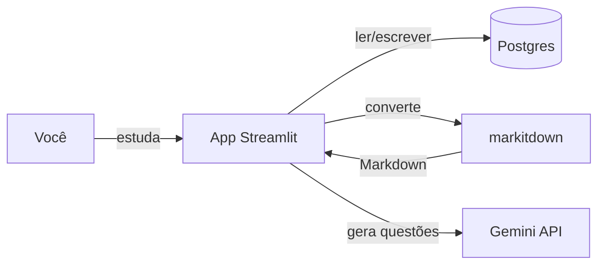

# PRD — EstudoConcurso (App de Questões)

**Versão:** 0.2.0 (MVP)
**Status:** Aprovado para desenvolvimento
**Idioma:** Documentação em pt-BR; código/identificadores em inglês.
**Dono do produto:** Você (usuário único no MVP)
**Arquiteto:** opencode (decisões técnicas delegadas)

---

## Controle do documento

| Versão | Data | Autor | Mudança |
|---|---|---|---|
| 0.1.0 | 2026-07-20 | opencode | Criação inicial do PRD (MVP) |
| 0.1.1 | 2026-07-20 | opencode | Ajustes: sem bloqueio automático de custo (usuário monitora); backup automático; definido template Markdown canônico |
| 0.1.2 | 2026-07-20 | opencode | Banco migrado para SQLite (zero instalação) via SQLAlchemy; troca para Postgres = mudar DATABASE_URL |
| 0.2.0 | 2026-07-20 | opencode | Importação de PDFs reais agora usa IA para estruturar o texto (parser canônico continua para arquivos já formatados) |

Toda mudança de escopo gera nova versão e registro no Changelog.

---

## Contexto

Você estuda para concursos públicos e quer praticar respondendo questões. Hoje usa um app caro e rígido para trocar de banca ou adicionar matérias, e precisa montar um prompt manual para cada banca quando gera questões. O objetivo é um app pessoal, simples, local, que importa provas reais e gera questões por IA com base na banca — sem trabalho manual de prompt.

## Problema

- Trocar de banca ou inserir matérias novas em apps existentes é custoso/complicado.
- Gerar questões por IA exige montar prompt para cada banca manualmente.
- Não há revisão focada nos erros.

## Visão do produto

Um app local (computador próprio) onde você (1) importa provas em PDF/Word/etc. convertidas para Markdown, (2) gera questões por IA informando apenas banca e matéria, e (3) estuda respondendo e revisando os erros. A IA fica na borda; o núcleo funciona sem ela.

## Fluxo principal

```
[Importar prova] -> markitdown -> Markdown -> parser canônico -> questions (DB)
[Banca+Matéria] -> AIProvider(Gemini) -> JSON único -> validação INV-1/5 -> questions (DB)
[Estudar] -> responder questão a questão -> attempts (DB) -> feedback certo/errado
[Revisar] -> filtrar attempts.correct=false -> responder erros de novo
```

## Invariantes

- **INV-1** — Toda questão precisa de enunciado, ≥2 alternativas e gabarito válido (1 ou mais corretas), independente do tipo (múltipla escolha ou certo/errado).
- **INV-2** — Nenhuma operação apaga dados permanentemente sem confirmação explícita.
- **INV-3** — O sistema funciona sem IA: responder questões importadas nunca depende de chamada de IA.
- **INV-4** — Toda questão `source=ai` passa pela mesma validação das importadas.
- **INV-5** — Toda questão `source=ai` deve conter justificativa para a alternativa correta e para cada alternativa incorreta.

## Objetivos

- Estudar respondendo questões importadas e geradas por IA.
- Organizar por banca e matéria com troca fácil.
- Revisar apenas as questões erradas.
- Persistir todas as questões geradas para reuso.

## Não objetivos

- Multiusuário / contas de terceiros (futuro → Radar).
- App mobile nativo.
- Parser de PDF com layout próprio (usamos markitdown).
- Estatísticas avançadas / dashboards.
- IA local / modelos self-hosted.
- Autenticação de usuários (app local de 1 pessoa).

## Hipóteses

- **H1** — Importo uma prova (PDF→MD) e tenho as questões prontas em < 5 min.
- **H2** — Gero 10 questões de uma banca em < 1 min, sem escrever prompt.
- **H3** — Respondo e vejo feedback em < 30s por questão.
- **H4** — Consigo revisar só as questões que errei.

## Personas

- **Estudante (você):** importa provas, gera questões, estuda e revisa erros.
- **Admin (você):** cria bancas/matérias, configura API key, gerencia dados.
- Sem outras personas no MVP.

## Métricas

| Métrica | Tipo | Alvo |
|---|---|---|
| Tempo de importação de prova | positiva | < 5 min |
| Tempo para gerar 10 questões | positiva | < 1 min |
| Tempo por questão respondida | positiva | < 30 s |
| % de acerto | positiva | acompanhar evolução |
| Nº de questões respondidas | positiva | crescer |
| Nº de erros revisados | positiva | crescer |

**Guardrails (métricas negativas):**
| Métrica | Limite |
|---|---|
| Custo mensal de IA | teto definido (ex.: R$ 50/mês) |
| Latência da chamada IA | < 30 s por lote |
| Uso de memória do app | < 500 MB |
| Nº de erros do app | 0 críticos |

## Épicos

- **E1 — Importação de questões** (provas reais)
- **E2 — Geração de questões por IA**
- **E3 — Estudo e resposta**
- **E4 — Revisão de erros**
- **E5 — Plataforma/base** (infra do Sprint 0)

## Requisitos

### E1 — Importação
- **E1.1** (P0) Importar arquivo (PDF/DOCX/HTML/etc.) e converter para Markdown via markitdown.
  - Aceite: arquivo vira Markdown processável; falha de conversão é reportada sem perda de dados.
- **E1.2** (P0) Parser canônico extrai questões de arquivos já no formato Markdown canônico, respeitando INV-1 (tipos múltipla e C/E).
  - Aceite: cada questão tem enunciado, alternativas e gabarito; questões inválidas são separadas.
- **E1.6** (P0) Para PDFs reais (texto livre, sem formato canônico), a IA estrutura o texto convertido em questões (gabarito extraído do texto), reusando o mesmo formato e validação.
  - Aceite: arquivo de prova real resulta em questões salvas; sem IA configurada, o erro é reportado. INV-3 segue válido (responder importadas não depende de IA em tempo de estudo).
- **E1.3** (P0) Usuário seleciona/cria a banca no momento do import.
  - Aceite: banca obrigatória; matéria opcional.
- **E1.4** (P1) Auto-divisão por matéria quando cabeçalho de seção for detectado; **não-bloqueante**; fallback = matéria única nomeada pelo usuário.
  - Aceite: se detectar "PORTUGUÊS", etc., agrupa; caso contrário importa sob matéria única. Nunca trava o import.
- **E1.5** (P0) Validar questões importadas conforme INV-1 antes de salvar.
  - Aceite: só questões válidas entram em `questions`.

### E2 — Geração por IA
- **E2.1** (P0) Gerar questões informando apenas banca e matéria, sem prompt manual.
  - Aceite: UI pede banca+matéria+quantidade; app monta o contexto.
- **E2.2** (P0) Uma chamada IA retorna questão + alternativas + justificativas (INV-5).
  - Aceite: resposta é um JSON estruturado único.
- **E2.3** (P0) Persistir toda questão gerada (revisão/reuso).
  - Aceite: toda `source=ai` vai para `questions`.
- **E2.4** (P0) Abstração `AIProvider`; Gemini hoje, trocável por config.
  - Aceite: trocar provider não exige mudança de regra de negócio.
- **E2.5** (P1) Modelo fixo (Gemini 1.5 Flash) e log de uso de custo.
  - Aceite: uso de IA registrado (evento `question_generated` com custo); sem bloqueio automático — usuário monitora o gasto.

### E3 — Estudo e resposta
- **E3.1** (P0) Responder questão a questão com feedback certo/errado.
  - Aceite: após responder, mostra gabarito e (se IA) justificativas.
- **E3.2** (P0) Funciona sem IA (INV-3).
  - Aceite: importadas respondem mesmo com IA offline.
- **E3.3** (P0) Trocar banca/matéria facilmente entre sessões de estudo.
  - Aceite: seletor de banca/matéria em 1 clique.

### E4 — Revisão de erros
- **E4.1** (P0) Listar e responder apenas questões erradas.
  - Aceite: filtro `attempts.correct=false`.
- **E4.2** (P0) Persistir tentativas (`attempts`).
  - Aceite: cada resposta gera registro.

### E5 — Plataforma (Sprint 0)
- **E5.1** (P0) Repositório, Docker (app), CI, lint, init do banco (SQLite via SQLAlchemy), observabilidade (logs), execução local.
  - Aceite: `docker compose up` (ou `streamlit run`) sobe o app; pipeline roda lint+testes; `python -m app.migrate` cria as tabelas.

## Requisitos não funcionais

- **Performance:** import < 5 min; gerar 10 questões < 1 min; responder < 30 s.
- **Backup:** `pg_dump` automático agendado (diário) para arquivo local, retenção de 7 dias.
- **Segurança:** API key somente em variável de ambiente; nada de segredos no código/repo.
- **Observabilidade:** logs estruturados (nível, ação, duração); erros de IA registrados.
- **Integrações:** Gemini API, markitdown. Falha de IA → app continua para importadas; erro logado e exibido, sem perda de dados.
- **Testes:** unitário (parser/validação INV-1/5), integração com IA mockada, e2e do fluxo responder.
- **Portabilidade:** roda em Docker no computador próprio (Windows).

## ADRs

| ID | Decisão | Alternativas | Justificativa |
|---|---|---|---|
| ADR-1 | Python + Streamlit | FastAPI+React | Mais simples p/ app pessoal local; markitdown e SDK Gemini são Python |
| ADR-2 | SQLite local via SQLAlchemy (JSON como JSON type) | Postgres, Mongo | Zero instalação no PC pessoal; trocar para Postgres depois é só mudar `DATABASE_URL` (SQLAlchemy gera o DDL de ambos); JSON cabe como JSON/JSONB |
| ADR-3 | Sem autenticação no MVP | JWT/OAuth | App local de 1 usuário; auth seria complexidade vazia |
| ADR-4 | Interface `AIProvider` + impl Gemini | acoplar Gemini direto | Troca de provedor fácil (exigência item 8) |
| ADR-5 | 1 chamada IA → JSON (questão+justificativas) | 2 chamadas | Menos custo/latência |
| ADR-6 | Modelo fixo + teto de custo + cache=banco | modelo premium | Controle de gasto; questões geradas já persistem |
| ADR-7 | markitdown → Markdown → parser | parser PDF próprio | Remove complexidade de layout |

## Arquitetura

App Streamlit (1 processo) → camada de serviço (regras determinísticas) → SQLite (SQLAlchemy). IA e markitdown são adaptadores na borda. Regras de negócio nunca dependem de IA para o fluxo de importadas.

**Como rodar (MVP, zero instalação de banco):**
```
python -m venv .venv && .venv\Scripts\activate
pip install -r requirements.txt
python -m app.migrate
streamlit run app/main.py
```
Backup: `python -m app.backup` (agendar no Agendador de Tarefas do Windows para diário).

## Diagramas



## Modelo de dados

- `banks` (id TEXT PK, name TEXT, source TEXT[imported|ai], created_at DATETIME)
- `subjects` (id TEXT PK, bank_id FK, name TEXT)
- `questions` (id TEXT PK, bank_id FK, subject_id FK null, source TEXT[imported|ai], type TEXT[multiple|ce], statement TEXT, alternatives JSON, answer JSON, justification JSON null, created_at DATETIME)
- `attempts` (id TEXT PK, question_id FK, user_answer JSON, correct BOOL, answered_at DATETIME)

IDs são TEXT com UUID gerado na aplicação. Campos JSON usam o tipo `JSON` do SQLAlchemy (vira JSON no SQLite, JSONB no Postgres). **Troca para Postgres:** alterar `DATABASE_URL` e instalar o driver `psycopg` (já listado em requirements).

**Relacionamentos:** bank 1─* subject; bank/subject 1─* question; question 1─* attempt.

**Formato canônico de importação (Markdown):** definido pelo arquiteto. O parser consome exatamente este padrão (cabeçalhos de banca/matéria opcionais; questões separadas por `## QUESTION`):

```markdown
# BANCA: FCC
# MATERIA: Português

## QUESTION
Enunciado da questão aqui (pode ter múltiplas linhas).

A) alternativa A
B) alternativa B
C) alternativa C
D) alternativa D
E) alternativa E

ANSWER: C

JUSTIFICATION:
A) por que está errada
B) por que está errada
C) por que está correta
D) por que está errada
E) por que está errada
```

Para tipo C/E, usar apenas `A) CERTO` / `B) ERRADO` e `ANSWER: A`. A seção `JUSTIFICATION` é opcional em importações e obrigatória em `source=ai` (INV-5).

## IA

- **Posição:** borda (geração de questões apenas).
- **Modelo:** Gemini 1.5 Flash (versão fixa).
- **Contrato:** 1 chamada retorna JSON `{statement, alternatives[], answer[], justification{alt: text}}`.
- **Cache:** questões geradas persistem em `questions` (reuso, sem nova chamada).
- **Custo:** modelo fixo de baixo custo (Flash); uso registrado por lote. Usuário monitora gasto manualmente (sem bloqueio automático).
- **Falha:** app segue funcional para importadas; erro logado e exibido.

## Integrações

- **Gemini API:** geração de questões (com key em env).
- **markitdown:** conversão de arquivo para Markdown no import.
- **Comportamento de falha:** ver seção Requisitos não funcionais.

## Eventos para observabilidade

- `question_imported` (bank, subject, count)
- `question_generated` (bank, subject, count, latency_ms, cost)
- `question_answered` (question_id, correct)
- `ai_call_failed` (provider, error)
- `cost_limit_reached`

## Estratégia de testes

- **Unit:** parser canônico e validação INV-1/INV-5 (questões válidas e inválidas).
- **Integration:** `AIProvider` com stub (sem chamar Gemini de verdade).
- **E2E:** fluxo importar → responder → revisar erro.
- **Gate:** CI verde (lint + testes) obrigatório para merge.

## Plano por sprints

- **Sprint 0 — Base:** repo, Docker, CI, lint, migrations, observabilidade, run local. (Auth removida por decisão ADR-3; "staging deploy" substituído por execução local via Docker.)
- **Sprint 1 — Importação (E1):** markitdown, parser, banca/matéria, validação. **✅ Implementada**
- **Sprint 2 — Geração IA (E2):** AIProvider, geração 1-chamada, persistência, teto de custo. **✅ Implementada**
- **Sprint 3 — Estudo e Revisão (E3+E4):** responder, feedback, troca banca, revisão de erros. **✅ Implementada**

**Status de implementação (MVP):** Sprints 0–3 entregues e cobertas por testes automatizados (pytest, 12 testes). Banco SQLite local (sem instalação). Pendente: S0-03 (CI) exige repositório remoto no GitHub; agendamento do backup (OS).

## Riscos

- markitdown pode não preservar numeração/estrutura → mitigado por parser tolerante + correção manual.
- IA alucina gabarito/formato → mitigado por INV-4/INV-5 e validação.
- Custo de IA fora de controle → mitigado por teto (E2.5).
- PDF sem cabeçalho de matéria → mitigado por fallback não-bloqueante (E1.4).

## Radar pós MVP

- Multiusuário (amigos).
- Estatísticas avançadas / dashboards.
- App mobile.
- IA local / modelo self-hosted.
- Parser de PDF nativo (sem markitdown).
- Exportar/importar banco de questões.

## Questões em aberto

- Qual teto de custo mensal exato de IA? (sugerido R$ 50)
- Formato final do template Markdown canônico (definir na Sprint 1).
- Quer agendamento automático de `pg_dump` ou backup manual?

## Glossário

- **Banca:** órgão que elabora a prova (ex.: FCC, Cebraspe).
- **Matéria:** disciplina dentro da prova (ex.: Português).
- **C/E:** questão do tipo Certo/Errado.
- **MVP:** mínimo produto viável (obrigatório).
- **Radar:** desejável, fora do MVP.

## Changelog

- 0.1.0 (2026-07-20): PRD inicial do MVP.
