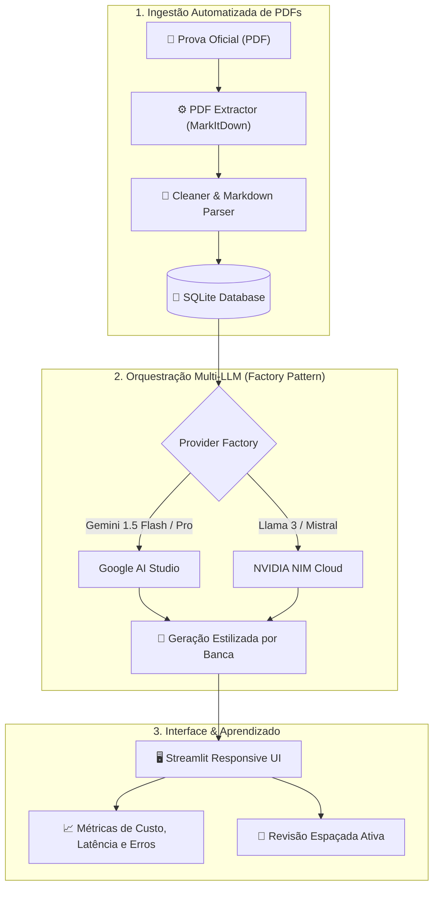

# 🎯 ConcursoCS — Multi-LLM Intelligent Study & Exam Platform

<p align="center">
  
  
  
  
  
  
</p>

Plataforma inteligente de preparação para concursos públicos e avaliações de alto rendimento. Combina **orquestração multi-provedor de LLMs (Google Gemini + NVIDIA AI Foundation)**, extração e parsing automático de provas em PDF, templates contextuais por banca examinadora e algoritmos de repetição espaçada.

Construído sob metodologia rigorosa de **Engenharia de Produto**: acompanhado de [`PRD.md`](PRD.md) completo, [`BACKLOG.md`](BACKLOG.md), suíte de testes com `pytest` e containerização via `Docker`.

---

## 💡 O Problema de Negócio & Usuário

Estudar para concursos de alto nível (Cesgranrio, FGV, FCC, CNU) exige resolver milhares de questões no estilo exato da banca. Plataformas tradicionais sofrem com:
1. **Bancos Estáticos:** Questões repetidas e sem contextualização dinâmica.
2. **Alucinação sem Contexto:** Chamar LLMs puras sem diretrizes de banca gera enunciados genéricos e fora do padrão.
3. **Falta de Ingestão Rápida:** Importar provas oficiais em PDF exige horas de trabalho manual de digitação e recorte de gabaritos.

---

## ⚡ A Solução: Arquitetura ConcursoCS



---

## 🛠️ Stack Tecnológica

* **Interface & Frontend:** Streamlit com componentes customizados de feedback visual e logs em tempo real.
* **Orquestração de IA:** Factory Pattern suportando Google Gemini (`google-generativeai`) e NVIDIA AI (`openai` client adaptado).
* **Processamento de Documentos:** Ingestão de PDFs via MarkItDown, extração de texto, parsing de gabarito e validação sintática.
* **Persistência:** SQLite otimizado com rotinas automáticas de backup (`backup.py`) e migração de schema (`migrate.py`).
* **Qualidade de Código:** Testes automatizados com `pytest` (smoke, parsing, import e generation), linter `ruff`.
* **Deploy & DevOps:** `Dockerfile` multi-stage e `docker-compose.yml`.

---

## 📂 Estrutura do Projeto

```
ConcursoCS/
├── app/
│   ├── ai/
│   │   ├── factory.py        # Provedor abstrato e seletor dinâmico de LLM
│   │   ├── gemini.py         # Integração Gemini 1.5 com fallback automático
│   │   ├── nvidia.py         # Integração NVIDIA NIM
│   │   └── provider.py       # Interfaces e contratos de inferência
│   ├── pdf_extractor.py      # Extração e parsing de PDFs de provas
│   ├── generation.py         # Prompt engineering e injeção de estilo por banca
│   ├── study.py              # Motor de estudo e repetição espaçada
│   ├── repository.py         # Camada de acesso a dados (Data Access Object)
│   ├── models.py             # Modelos de domínio
│   └── main.py               # Ponto de entrada Streamlit
├── provas/                   # PDFs de provas reais e gabaritos oficiais
├── tests/                    # Suíte completa de testes unitários e de integração
├── PRD.md                    # Documento de Requisitos de Produto (Product Specs)
├── BACKLOG.md                # Roadmap e controle de entregas
├── docker-compose.yml        # Configuração de deploy local
└── Dockerfile                # Imagem de produção
```

---

## 🚀 Como Executar

### Pré-requisitos
* Python 3.11+
* Chave de API do Gemini (`GEMINI_API_KEY`) no arquivo `.env`

### Passo a Passo

```bash
# 1. Clonar o repositório
git clone https://github.com/CauaRibeiroXY/ConcursoCS-AI-Platform.git
cd ConcursoCS-AI-Platform

# 2. Criar e ativar o ambiente virtual
python -m venv .venv
source .venv/bin/activate  # No Windows: .venv\Scripts\activate

# 3. Instalar dependências
pip install -r requirements.txt

# 4. Configurar variáveis de ambiente
cp .env.example .env

# 5. Executar a aplicação
streamlit run app/main.py
```

### Executar via Docker
```bash
docker compose up --build
```

---

## 👨‍💻 Autor

Desenvolvido por **[Cauã Ribeiro](https://github.com/CauaRibeiroXY)**  
*Acadêmico de Ciência da Computação (IFNMG) • AI Builder & Engenheiro de Software*
